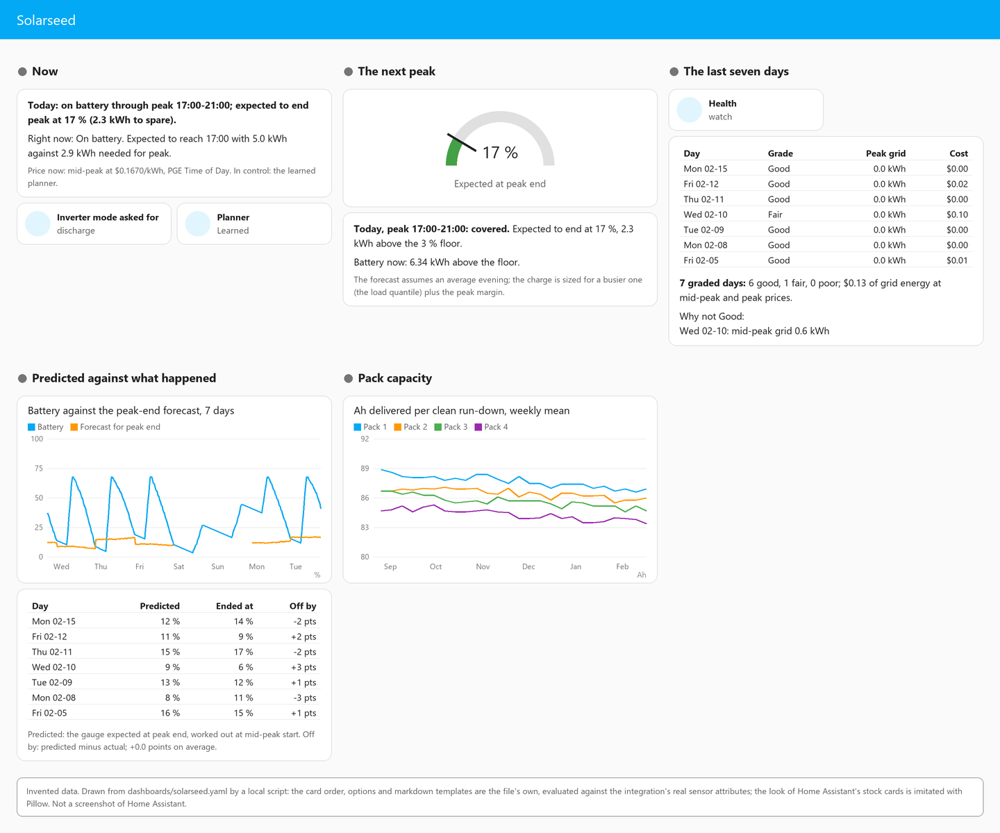

# [Solarseed](https://johnnysolarseed.org) Peak Shaver

**A Home Assistant integration for solar + battery peak shaving.**

If you have solar panels, a battery, and time-of-use electricity rates, this integration figures out how much to charge your battery overnight so you can ride through the expensive hours on solar and stored energy - instead of paying peak rates to the grid.

## The problem it solves

You're on TOU rates. You have solar and a battery. Every night you face the same question: *how much should I charge from the grid while rates are cheap, so I don't get caught buying power at peak prices tomorrow?*

Charge too much and you wasted money on grid power you didn't need - the sun would have covered it. Charge too little and you're buying power at 3-5x the off-peak rate during the evening peak.

The Peak Shaver answers that question automatically, every night, using your solar forecast. It handles the calculations, monitors your battery, sends you notifications, and tells your inverter what to do - through automation blueprints you configure once.

It has two planners. The **learned planner** measures how your battery charges and runs down and what your house draws hour by hour, and plans from that; a new install with the sensors it needs starts with it in control (see [Learned planner](#learned-planner)). The **classic planner** is the original one, described next; it is **legacy** from 0.9.3: still selectable and still computing beside the learned one, with no new features.

## How it works (the classic planner, legacy)

1. Runs at your scheduled hours (default: 3, 4, 5, 6 AM) and whenever the solar forecast updates
2. Reads your current battery level and the hourly solar production forecast
3. Projects your battery level at mid-peak start, accounting for overnight drain
4. Simulates hour-by-hour through mid-peak and peak: solar production minus your base load
5. Finds the lowest point - if the battery would drop below your safety floor, calculates exactly how much more charge you need
6. Fires an event to start grid charging (or confirms no charging is needed)
7. Monitors the battery and fires a stop event when the target is reached
8. Sends you notifications at each step (if enabled)

### Three-tier rate awareness

The shaver understands three rate periods: off-peak, mid-peak, and peak. This matters because if there's going to be a deficit during peak, it's better to charge during mid-peak at a moderate rate than to buy power at full peak pricing. The forecast recalculation window runs from your overnight schedule hours through peak start - so a forecast update during mid-peak can still trigger a charge decision before the most expensive hours hit.

For PGE's Time of Day plan as an example: mid-peak is 7 AM - 5 PM and peak 5 PM - 9 PM on weekdays, off-peak the rest of the time; the integration's PGE defaults are $0.1670/kWh mid-peak and $0.4313/kWh peak. Your own hours and prices go in the Tariff screen. (`tools/analyze_performance.py`, an offline tool for exported CSVs, prices with its own fixed rates of $0.09, $0.18 and $0.44, not with your tariff.)

### Off-peak battery hold

During low-solar months (configurable, default Nov-March), the integration fires a hold event at the end of peak hours. The idea: in winter, your solar won't refill the battery tomorrow. Instead of letting it drain overnight on household loads, the integration tells your inverter to hold the current battery level and draw from the grid for everything else. Your stored energy stays put until the next peak window when you actually need it. The next morning's scheduled calculation run takes over from there, deciding whether any additional off-peak charging is needed.

## What you need

- **Home Assistant 2024.12 or later** (the settings menu needs it: the options flow reads its config entry the way Home Assistant provides it from 2024.12; the dashboard needs 2024.10, the blueprints 2024.8).
- **A battery and inverter** whose operating mode Home Assistant can set (a `select` or a `switch`), with sensors for the battery: its energy in kWh (a template of percent times capacity works) and, for the learned planner, the inverter's AC output power (house load) and AC input power (from the grid), plus its own battery percent and solar input if it has them. Tested on one inverter family only, a Bluetti AC500; the integration never talks to the inverter itself, so others work if their modes can charge from grid, run on battery, and hold the battery while the grid carries the house.
- **The [Solcast PV Forecast](https://github.com/BJReplay/ha-solcast-solar) integration** for the solar forecast. Only Solcast's shape is read (hourly detail in a `detailedHourly` or `detailedForecast` attribute, which Solcast's options can turn on); Forecast.Solar and others do not have it, and the integration then sees no solar and raises a repair notice saying so.
- **Time-of-use electricity rates** that fit three windows a day: off-peak, then mid-peak running straight into peak, peak ending by 23:00. A plan with only two prices (no mid-peak) is accepted; the learned planner then holds the battery on grid power from the night charge until peak start, which is right by price but has not yet been watched on an inverter. A plan with two peak windows a day is refused in the form.

## Installation

### HACS (recommended)

1. Open HACS in Home Assistant
2. Three-dot menu > **Custom repositories**
3. Add `https://github.com/danrichardson/solarseed-peak-shaver` as an **Integration**
4. Search for "Solarseed Peak Shaver" and install
5. Restart Home Assistant
6. **Settings > Devices & Services > Add Integration** > search "Solarseed"
7. Import the three blueprints and make an automation from each ([Step 2](#step-2-import-the-blueprints)). Without them the integration decides and nothing happens; it raises a repair notice ("nothing acts on its events") until they are there.

### Manual

Copy `custom_components/solarseed_peak_shaver` into your Home Assistant `config/custom_components/` directory. Copy the `blueprints` folder into your Home Assistant `config/blueprints/` directory. Restart.

## Setup

### Step 1: Integration config (4 screens)

Every field in the forms says what to pick and what happens if you leave it empty. In short:

**Screen 1 - Battery and solar forecast**

| Setting | What to pick | Example |
|---------|--------------|---------|
| Battery energy sensor (kWh) | Required. The energy in the battery now | `sensor.available_battery_kwh` |
| Solar forecast sensor (today) | Required. Solcast's today forecast | `sensor.solcast_pv_forecast_forecast_today` |
| Usable battery capacity | Full to empty, in kWh | 23.5 kWh |
| Average house load | The classic planner's load, and the learned one's until it has history | 0.6 kW |
| Minimum safe energy (classic planner, legacy) | Keep the default if you use the learned planner | 1.5 kWh |
| Solar production today | Optional; for the classic planner's forecast scoring | (empty) |

**Screen 2 - Learned planner sensors** (all optional)

| Setting | What to pick |
|---------|--------------|
| Battery gauge (percent) | The percent the inverter reports. Empty: worked out from energy and capacity |
| House load power (inverter output) | The power the inverter delivers to the house |
| Grid power into the inverter | The power the inverter takes from the grid |
| Solar power into the inverter | Empty only if your panels do not charge this battery |
| Solar forecast sensor (tomorrow) | Solcast's tomorrow forecast; filled in when it exists |

**Pick both the house load and the grid power sensor and the new install starts with the learned planner in control.** Leave both empty and the classic planner (legacy) is in control. One without the other is refused. Entries made before 0.9.3 keep the planner they had.

**Screen 3 - Tariff**

| Setting | What it means | Default (PGE Time of Day) |
|---------|--------------|---------|
| Mid-peak start | When mid-peak prices begin; the peak start hour if there is no mid-peak | 7 |
| Peak start | When the dearest prices begin | 17 |
| Peak end | When peak ends, 23 at the latest | 21 |
| Weekdays only | Mid-peak and peak Monday to Friday only | Yes |
| Off-peak, mid-peak, peak price | Per kWh; off-peak is optional, peak not below mid-peak | -, 0.1670, 0.4313 |
| Utility holidays | Days priced off-peak all day: None, PGE or US federal | PGE |
| Calculation hours (classic planner, legacy) | When the classic planner recalculates | 3,4,5,6 |

The hours and prices are checked as the Tariff options check them; seasons, weekend hours, your own holiday rules and one-off dates are in the options afterwards.

**Screen 4 - Notifications**

| Setting | What it means | Default |
|---------|--------------|---------|
| Enable notifications | The daily report after peak, a review notice, alerts | Yes |
| Notification service | Your notify target, e.g. `notify.mobile_app_yourphone`; empty: none | (empty) |
| Minimum charge, Off-peak battery hold, Hold months | Classic planner (legacy) only | 0.5 kWh, Yes, 11,12,1,2,3 |

**If something is missing,** Home Assistant's repairs list (Settings > System > Repairs) shows it, and the log has one line for it: a configured sensor that does not exist, the learned planner in control without its load and grid sensors, a forecast without Solcast's hourly detail, or an event the planner fires that no enabled automation listens to. The integration checks every ten minutes once Home Assistant is running, and a notice clears itself after the fix. It never notifies your phone about these and never acts on them.

All settings can be changed later through the integration's **Configure** button, which
opens a menu of sections (Battery and sensors, Tariff, Learned planner, Third-party packs,
Notifications, Classic planner (legacy)). Saving a section changes only that section. The Tariff
section holds the rate hours, the prices per kWh, optional seasons and the utility holidays
(presets for PGE and US federal, or your own rules such as `11-thu-4` and one-off dates);
the defaults are PGE Time of Day. The planner, the utility holidays and four
learned-planner tuning values are also settings on the device page, and take effect within
a minute without a restart.

### Step 2: Import the blueprints

The integration tells your battery *what* to do. The blueprints tell your inverter *how* to do it.

Go to **Settings > Automations & Scenes > Blueprints**, click **Import Blueprint**, and paste each URL below. After importing, click **Create Automation** from each blueprint to configure it. Each one asks for just two things: your inverter's mode entity and the value to set. Use the same mode entity in all three. The values in the examples are a Bluetti AC500's (Bluetti integration, `select.ac500_ups_mode`), the one inverter this has run on; for another inverter pick the option that does the same thing, written exactly as its select lists it, and watch it for an evening.

**Solarseed - Start Grid Charging** ([import](https://github.com/danrichardson/solarseed-peak-shaver/blob/main/blueprints/automation/solarseed_peak_shaver/charge_start.yaml))

```
https://github.com/danrichardson/solarseed-peak-shaver/blob/main/blueprints/automation/solarseed_peak_shaver/charge_start.yaml
```

The battery charges from the grid. The learned planner asks for it for the night charge before a TOU day (timed to end at mid-peak start) and for a mid-peak top-up (to end by peak start); never in peak. AC500: `STANDARD`.

**Solarseed - Stop Charging / Solar Priority** ([import](https://github.com/danrichardson/solarseed-peak-shaver/blob/main/blueprints/automation/solarseed_peak_shaver/charge_stop.yaml))

```
https://github.com/danrichardson/solarseed-peak-shaver/blob/main/blueprints/automation/solarseed_peak_shaver/charge_stop.yaml
```

The house runs on solar, then battery. Asked for at mid-peak start, when a top-up is done, and whenever the plan is to run on battery. AC500: `PV_PRIORITY` (its own low-battery setting hands the house to the grid at the floor, which is the learned planner's gauge floor option).

**Solarseed - Off-Peak Battery Hold** ([import](https://github.com/danrichardson/solarseed-peak-shaver/blob/main/blueprints/automation/solarseed_peak_shaver/preserve_start.yaml))

```
https://github.com/danrichardson/solarseed-peak-shaver/blob/main/blueprints/automation/solarseed_peak_shaver/preserve_start.yaml
```

The battery keeps its charge and the grid carries the house. The learned planner holds on the night before a TOU day, from peak end until mid-peak start, around the night charge; the classic planner (legacy) after peak in its hold months. The mode must not discharge the battery. AC500: `TIME_CONTROL` (on the unit this was built with it passes the grid through and keeps the battery; what it does depends on the time-control windows set in the Bluetti app).

The blueprints handle both `select` and `switch` entity types (a switch is turned on to charge and off otherwise; it has no hold). Automations of your own triggered by the three events work as well (see [Events](#events)).

## Sensors

The classic planner (legacy) has five sensors under the "Solarseed Peak Shaver" device:

| Sensor | What it tells you |
|--------|-------------------|
| **Target SOC** | How much energy your battery should have (kWh) |
| **Charge Needed** | How much to add from the grid overnight (kWh) |
| **Projected Minimum Battery** | The lowest your battery will get during the rate window |
| **Battery at Peak Start** | Where your battery will be when mid-peak rates begin |
| **Charge Below** | The SOC threshold where charging would kick in (kWh) |

**Charge Below** answers the question: "how low would my battery have to be *right now* before the algorithm starts charging?" It's calculated as your current SOC minus the headroom between the projected minimum and the safety floor. If your battery is above this value, you're safe. If it drops below, the next calculation will trigger grid charging. It's a quick way to gauge how much margin you have on any given day.

### Learned planner

The original planner assumes one percent of battery is worth `capacity / 100` kWh and
that the house draws one fixed base load. On a real system both can be well off, and
both drift. From 0.7.0 the integration can measure them instead, and from 0.9.3 a new
install with the house load and grid power sensors starts with the learned planner in
control.

An install that started on the classic planner (every entry made before 0.9.3, or one set
up without those sensors) adds them under **Configure**, **Battery and sensors**, and
switches the **Planner** select on the device page (or **Configure**, **Learned planner**):

| Setting | What to pick |
|---------|--------------|
| **Battery gauge (percent)** | The percent your inverter reports. Optional; derived from energy and capacity if empty |
| **House load power (inverter output)** | Power the inverter delivers to the house |
| **Grid power into the inverter** | Power the inverter takes from the grid |
| **Solar power into the inverter** | Optional; empty only if the panels do not charge this battery |
| **Planner in control** | `Classic (legacy)` to watch it first, `Learned` to hand it control |

With the planner on `classic` nothing about control changes. These sensors show what
the learned planner would do and why:

| Sensor | What it tells you |
|--------|-------------------|
| **Learned Plan** | `charge`, `hold` or `discharge`, with the reason and target as attributes |
| **Learned Energy Remaining** | kWh the battery will deliver before the inverter hands over to the grid, from the learned curve |
| **Plan Summary** | The plan in one plain sentence (0.9.2) |
| **Peak End Forecast** | The gauge expected at the end of the next planned peak window, in percent (0.9.2) |

Call `solarseed_peak_shaver.backfill_learning` once to train it from your recorder
history; until it has a few days of history it charges to full every night before a TOU
day. On the classic planner, when its plans look right for a few days, switch **Planner in
control** to `learned`. It drives the same three events, with these rules: never charge in the
peak window; charge in mid-peak only to cover the peak window and finish before it;
time the overnight charge to end when mid-peak starts and hold the battery until then;
in the months you list as "full", charge every night before a TOU day until the inverter
stops. Switching back to `classic` is the same one setting.

Details: [docs/how-it-works.md](docs/how-it-works.md).

### Dashboard (0.9.2)

[`dashboards/solarseed.yaml`](dashboards/solarseed.yaml) is a ready dashboard made of stock
cards only (Home Assistant 2024.10 or later). It answers, in order: what it is doing now and
why; whether the next peak will be covered; how the last seven graded days went, in grades
and dollars; what it predicted against what happened; and the third-party packs' capacity
trend, if you track packs. Create a new dashboard, open its raw configuration editor, and
paste the file; set your battery gauge (and pack sensors) in the id list at the top first.



The picture uses invented numbers and is drawn by a script from the file's own cards and
templates, not photographed in Home Assistant.

## On-demand recalculation

You don't have to wait for the next scheduled run. There are two ways to trigger the calculation immediately:

**Button entity** - A "Recalculate" button is created under the Solarseed Peak Shaver device. Press it from the dashboard, an automation, or the entity page. You'll find it at `button.solarseed_peak_shaver_recalculate`.

**Service call** - Call `solarseed_peak_shaver.recalculate` from Developer Tools > Services, scripts, or automations. No parameters needed.

Both methods run the full calculation, update all sensors, and fire events exactly as a scheduled run would.

## Events

The integration fires these events on the Home Assistant event bus. The blueprints listen for them, but you can also use them in your own automations.

| Event | When | Data |
|-------|------|------|
| `solarseed_peak_shaver_charge_start` | Charging is needed | current_soc, target_soc, charge_needed, solar_forecast |
| `solarseed_peak_shaver_charge_stop` | Target reached or no charging needed | current_soc, target_soc |
| `solarseed_peak_shaver_preserve_start` | Off-peak battery hold triggered | current_soc, month |

## Background

Discussion and development history on the [DIY Solar Power Forum](https://diysolarforum.com/threads/using-homeassistant-for-peak-shaving.105312/).

Part of the [Johnny Solarseed](https://johnnysolarseed.org) project - teaching Oregon homeowners to build and manage their own solar systems.

## License

MIT

## Contributing

Issues and PRs welcome. If you're running this on a different inverter/battery combo, I'd love to hear how it works for you.
